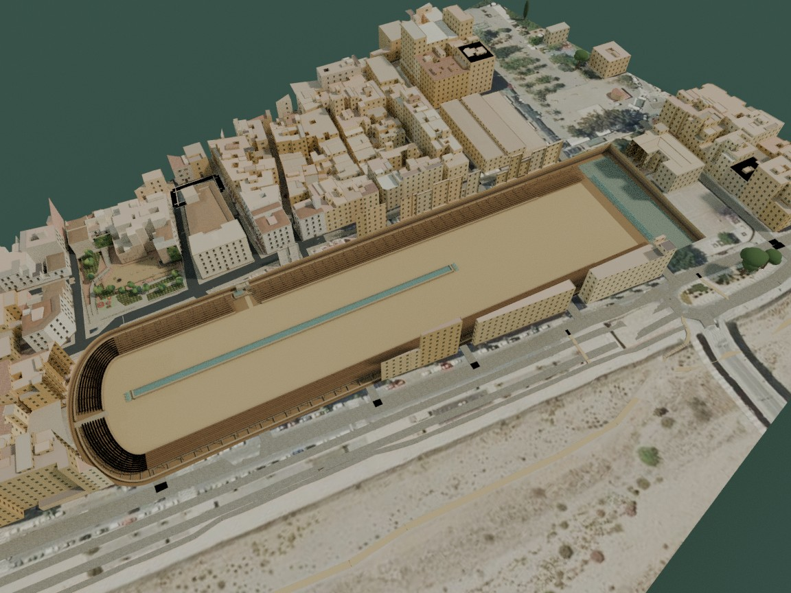
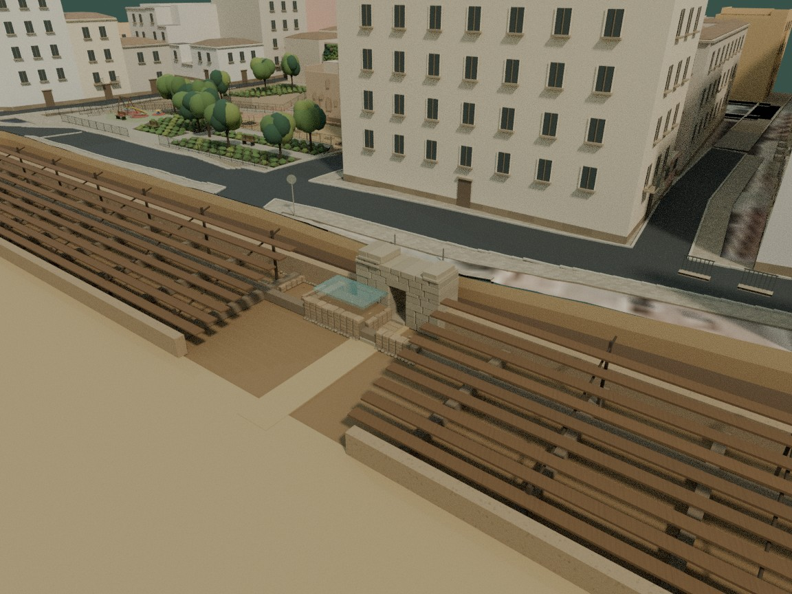
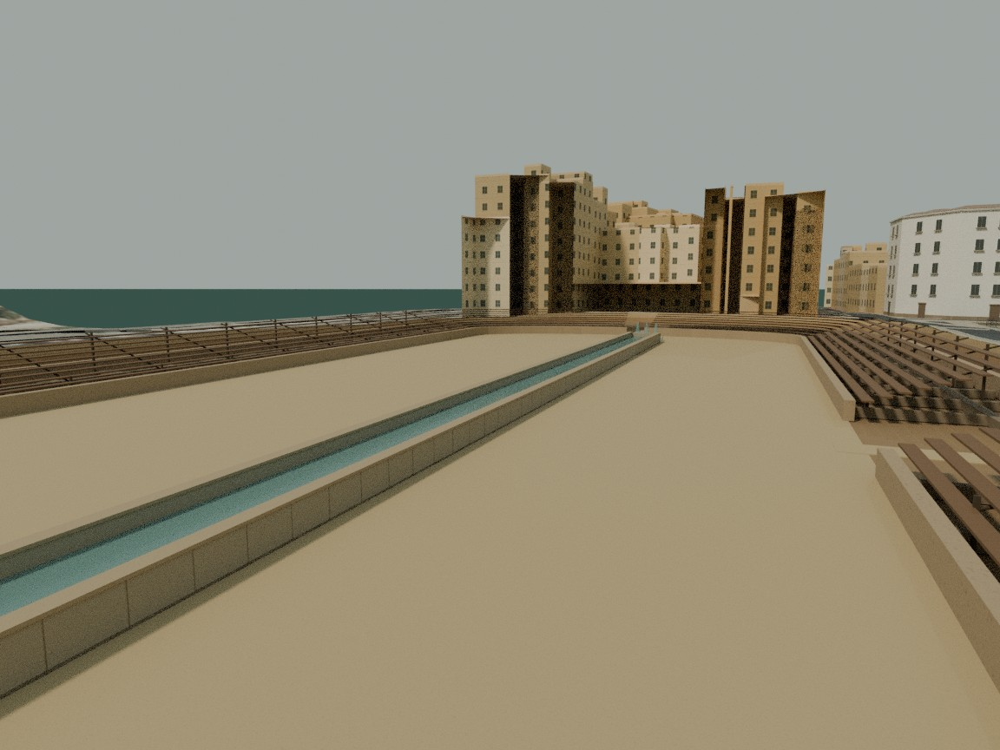
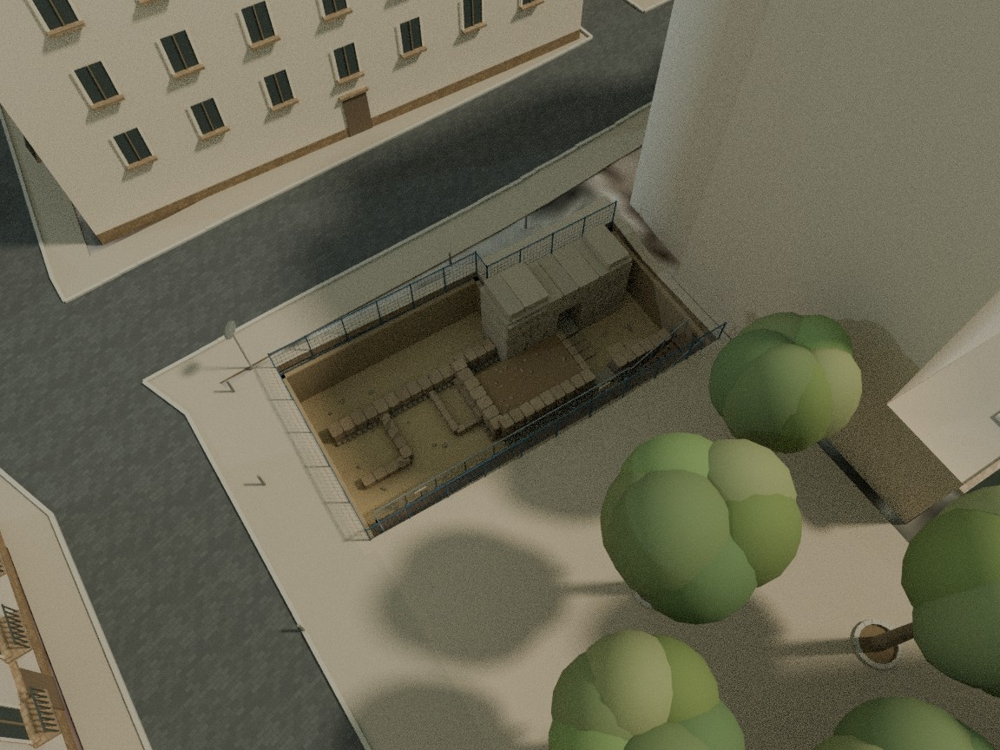

# V53 · Circo romano completo

Revisión del 27 de noviembre de 2026 sobre Sites V52, fuente `7c798336b46556233de8117492be11fed15b14ab`.

## Resultado

La visita de la Puerta del Circo incorpora dos presentaciones: **Puerta actual** y **Circo completo**. La primera mantiene el recinto arqueológico y la ciudad contemporánea. La segunda retira el contexto dentro del contorno histórico, muestra el conjunto longitudinal y conserva la puerta meridional como referencia fija. Atlas y Simulador utilizan el mismo registro cartográfico, las mismas 20 paradas y planos coherentes.

El catálogo mantiene sus 33 lugares: Sagunto 1–17, Puerto 18–26 y costa y paisajes 27–33. El Circo conserva el número 11 y la Plaza del Fórum el 12. Los otros 32 registros de encuadre y paradas mantienen sus contenidos.

## Evidencia y decisiones de modelado

- [Matriz de fuentes, medidas y límites](circo-evidence.md): trabajos de Melchor y colaboradores en ARSE y Tarraco Biennal, informe de excavación y transcripciones de Chabret y Bru.
- [Registro cartográfico](circo-registration.md), [contrato geométrico](circo-registration.json) y [superposición](circo-registration-overlay.jpg): correspondencia entre la figura publicada y su ortofoto ICV de 2012.
- El modelo usa 273 m de longitud aproximada y 70 m de anchura exterior. El cierre occidental muestra el intervalo de 270–290 m. Los 237 m identificados en 1938 corresponden a la cimentación reconocible, no al edificio completo.
- La *spina* de 151 m sigue la propuesta fotogramétrica de Tarraco Biennal. La sección descrita por Bru se incorpora como interpretación volumétrica y se explica su procedencia distinta.
- La cabecera oriental se aproxima mediante una curva achatada de 22 m de profundidad y 35 m de semianchura. No se presenta como una elipse romana exacta. El encaje adopta una tolerancia interpretativa de 3–5 m; los residuos de correspondencia de imágenes no se confunden con precisión arqueológica.
- La puerta actual permanece fija. El conjunto histórico se desplaza aproximadamente 24,5 m hacia el este respecto de la posición anterior para ajustarse al plano publicado. El cierre occidental continúa incierto.
- Gradas, metae, agua y alzado de tribuna son hipótesis visuales opcionales. El cierre de las carceres es esquemático y no inventa un número documentado de cajones.

## Verificación

| Comprobación | Evidencia |
| --- | --- |
| Ancla de la puerta, planta, dimensiones, 20 paradas, máscaras y restauración | [15 comprobaciones del modelo](circo-layer-qa.json) |
| Conjunto completo en cuatro tamaños, con panel abierto o cerrado | Ocho proyecciones en `circo-layer-qa.json` |
| Cámaras, paradas y contenido de los otros 32 lugares | [Informe de integración](circo-integration-report.json) |
| Suelo transitable, barreras y tres ciclos de restauración | [Informe del Simulador](circo-simulator-report.json) |
| Recorte GLSL, nodos TSL compilados a WGSL y sombras | [Pruebas de sección](test-circo-section.mjs) |
| Planos actual e histórico, incluidos marcadores seleccionables | [Prueba del plano del Simulador](test-circo-simulator-map.mjs) |
| Inspección visual de la geometría exportada de producción | [Registro de cuatro renders CPU](render-inspection.json) |
| Interfaz y rutas, incluido cambio de capa sin WebGL | [Revisión de navegador](browser-qa.json) y [prueba de fallback](test-circo-fallback.mjs) |
| Alcance de integración y comandos | [Nota de integración](integration-qa.md) |

Los renders utilizan las mallas, UV, texturas y materiales del constructor real, con sustracción geométrica de las mismas máscaras de contexto. Se inspeccionaron el conjunto, la puerta conservada dentro del edificio completo, la barrera central y el estado actual. No son fotografías arqueológicas ni capturas del motor WebGL.









### Reproducción de las comprobaciones

Desde la raíz del checkout, con las dependencias Node y Canvas indicadas en los scripts:

```sh
node research/validation-v53/test-circo-layer.mjs
node research/validation-v53/test-circo-simulator.mjs
node research/validation-v53/test-circo-section.mjs
node research/validation-v53/test-circo-simulator-map.mjs
node research/validation-v53/test-circo-fallback.mjs
node research/test-atlas-order.mjs
git diff --check
```

`build-circo-plan.mjs` regenera el plano a partir de la geometría. `export-circo-cameras.mjs` actualiza exclusivamente los índices del Circo. `export-circo-geometry.mjs` y `render_circo.py` exportan y dibujan las mallas con Blender en CPU. No se requiere regenerar los demás monumentos.

### Alcance y límites

El navegador de revisión no dispone de WebGL 2. Se comprueban los controles, rutas, documentación y planos mediante la interfaz; los constructores, máscaras, colisiones, cámaras y shaders se comprueban mediante sus implementaciones reales en CPU. No se atribuye a estas pruebas una medición de rendimiento GPU ni una revisión física en iPad. La imagen histórica sigue siendo una restitución documentada con incertidumbres explícitas, no un levantamiento arqueológico completo.

La compactación de siete JSON de distribución elimina únicamente espacios externos a cadenas, sin modificar números, claves ni valores. El [registro de equivalencia](distribution-json-equivalence.json) documenta un ahorro de 927.128 bytes para mantener el paquete dentro del límite de Sites. Los datos arqueológicos de otras visitas permanecen intactos.

La publicación y su revisión pública quedan registradas en [SITES_SYNC](../../docs/SITES_SYNC.md).
